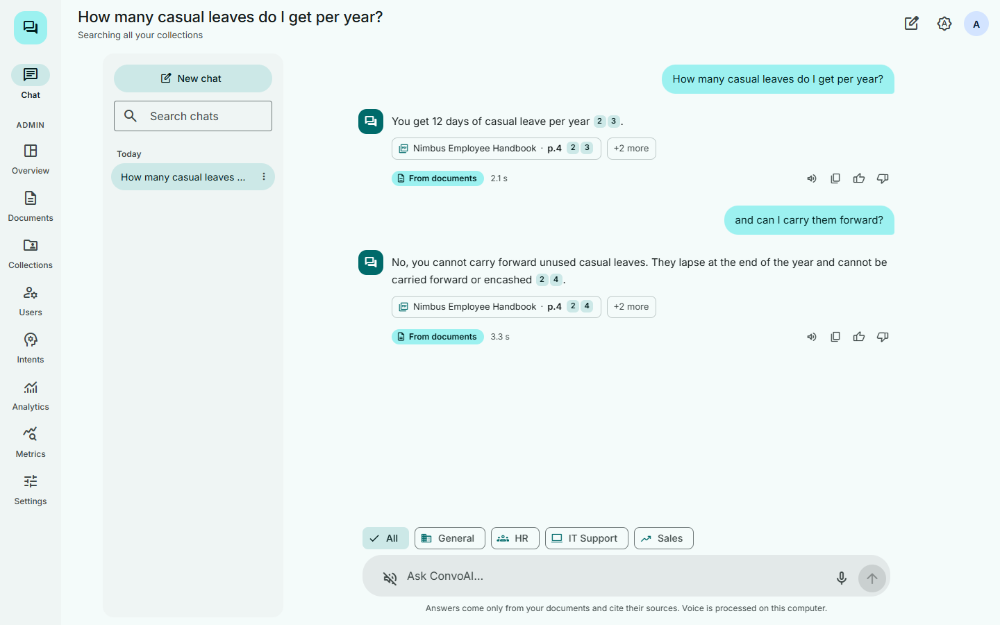
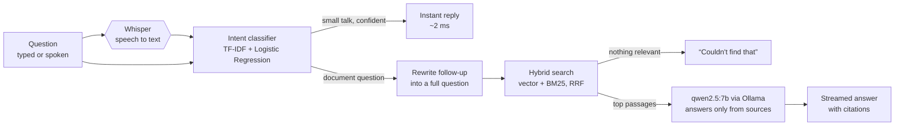

# ConvoAI

**A private company assistant that answers questions from your own documents.** Ask about leave, VPN, pricing or any policy in plain English, or by voice. ConvoAI finds the relevant passages, answers with citations you can click, and says so when the documents don't cover something. Everything runs on one computer: the language model, the search index, speech recognition and your chat history. Nothing is sent to the internet.

MCA project, Karnataka State Open University (2026): *ConvoAI, an intelligent conversational chatbot using Python and Natural Language Processing*, extended with Retrieval-Augmented Generation.



## Quick start (Windows)

1. Install **Python 3.11** (tick *Add python.exe to PATH*) and **[Ollama](https://ollama.com/download)**.
2. Double-click **`setup.bat`**. The first run takes about 20 minutes: it installs packages, downloads about 7 GB of models, trains the classifier and loads the sample documents.
3. Double-click **`start.bat`**. ConvoAI opens in your browser at http://127.0.0.1:5000. There is no sign-in.

Then try *"How many casual leaves do I get per year?"*, follow up with *"and can I carry them forward?"*, or tap 🎤 and ask aloud.

Hardware used for development and testing: a laptop with an NVIDIA RTX 3060 (6 GB) and 39 GB RAM. It also runs on CPU only, more slowly; for that, choose `llama3.2:3b` in Settings.

## How it works



1. **Classify.** A TF-IDF + Logistic Regression classifier (NLTK pre-processing, compared against Naive Bayes) catches greetings, thanks and questions about the assistant, and replies instantly.
2. **Retrieve.** Other questions are rewritten if they're follow-ups, then searched two ways in the collections the user may see: meaning (ChromaDB + `nomic-embed-text`) and keywords (BM25). The two rankings are fused with Reciprocal Rank Fusion.
3. **Gate.** If nothing is similar enough, the user gets a polite "not found" instead of a guess. Between a floor and the threshold, a question still passes when keyword search independently agrees.
4. **Answer.** `qwen2.5:7b-instruct` reads the top passages and answers with citations [1], [2], streaming word by word. Every turn is stored with its route, timing and sources for Analytics.

Documents (PDF, Word, text, Markdown or a web page) are split into ~800-character chunks that keep their page and heading, embedded on the GPU, and indexed in the background.

## Features

| | |
|---|---|
| **Chat** | Streaming answers, clickable citations, a sources panel with highlighted passages, follow-up questions, conversation history (search, rename, delete, links), 👍/👎, copy, stop, light/dark theme, phone layout |
| **Voice** | 🎤 speech-to-text with Whisper on this PC (auto-stops on silence); answers read aloud with installed Windows voices |
| **Documents** | Upload or add URLs per collection (HR, IT Support, Sales…), watch indexing, view chunks, rename/move, re-index, test retrieval |
| **Admin** | Collections, intents editor with retraining, settings (models, thresholds, chunking, voice), users (when sign-in is on) |
| **Analytics** | Usage, answer routes, response times, most-cited documents, *content gaps* (questions the documents couldn't answer), 👎 answers |
| **Metrics** | Classifier comparison, confusion matrix, threshold tuning, retrieval evaluation with a re-run button |

See the **[User manual](docs/USER_MANUAL.md)** for every screen.

## Results

From [docs/TEST_REPORT.md](docs/TEST_REPORT.md) (97 automated tests, 80% line coverage; 89% of the code that runs inside the app):

| What was measured | Result |
|---|---|
| Intent classifier, 100 unseen phrasings | Logistic Regression: accuracy 0.910, macro-F1 0.905 (Naive Bayes 0.890 / 0.875) |
| Retrieval, 46 questions with a known answer passage | Hybrid search: right passage in the top 5 for 97.8%, MRR 0.935 |
| End-to-end answers, 41 document questions | 92.7% correct facts, 100% correct citations; all 8 off-topic questions declined |
| Speed (RTX 3060) | Small talk ~2 ms; document answers start after 1.6 s and finish in ~3 s (medians); voice transcription ~2 s |

Known limitations, discussed in the report: a 7B model still misreads rules that span two sections (for example, which cities count as "metro" for the per diem). The test sets were written for the sample documents, so expect slightly lower scores on new ones.

## Configuration

Most settings are on **Admin → Settings**: models, temperature, sources per answer, thresholds, chunking and the Whisper model. Start-up options go in `.env` (copy `.env.example`):

| Variable | Default | Purpose |
|---|---|---|
| `LOGIN_REQUIRED` | `0` | `1` = require accounts and per-department collection access |
| `ADMIN_NAME` | `Administrator` | The name the assistant greets you with |
| `OLLAMA_HOST` | `http://127.0.0.1:11434` | Where Ollama runs (use 127.0.0.1, not localhost, on Windows) |
| `PORT` | `5000` | Web port (`start.bat` switches to 5050 if 5000 is busy) |
| `FLASK_DEBUG` | `0` | `1` for development (auto-reload) |

## Developer commands

```bash
.venv\Scripts\python app.py                         # run (or start.bat)
.venv\Scripts\python -m pytest -q                   # tests
.venv\Scripts\python -m nlp.train [--reseed]        # retrain the intent classifier (and reload data/intents.json)
.venv\Scripts\python -m rag.evaluate [--apply]      # retrieval evaluation (and save the tuned threshold)
.venv\Scripts\python -m rag.answer_eval --models qwen2.5:7b-instruct llama3.2:3b
.venv\Scripts\python tools/make_test_report.py      # rebuild docs/TEST_REPORT.md from saved results
.venv\Scripts\python tools/load_sample_docs.py      # load the Nimbus sample documents
.venv\Scripts\python tools/take_screenshots.py      # regenerate docs/screenshots (needs: pip install playwright)
```

API: `POST /api/chat` and `POST /api/chat/stream` (Server-Sent Events), plus REST endpoints for conversations, feedback, documents, collections, intents, settings, analytics and metrics. They are listed at the top of each file in `routes/`.

## Project layout

```
app.py, config.py         app factory, settings
models/                   SQLite schema + data access (database.py), user model
nlp/                      preprocessing, intent classifier (train/compare/predict), evaluation
rag/                      loaders, chunker, embeddings, Chroma + BM25 store, hybrid retriever,
                          prompts, Ollama LLM client, retrieval + answer evaluation
services/                 router (the chat pipeline), ingestion worker, speech, analytics, settings schema
routes/                   page and JSON API blueprints
templates/, static/       Jinja2 + Material Web (Material 3) UI, Chart.js; static/vendor is bundled for offline use
data/                     intents.json, evaluation sets, sample documents; runtime data (db, chroma, models) is git-ignored
docs/                     user manual, test report, UAT checklist, demo script, report notes, screenshots
tests/                    pytest suite
tools/                    sample-document builder/loader, test report, screenshots, vendor bundle build
setup.bat, start.bat      one-click setup and start (Windows)
```

## Troubleshooting

| Problem | Fix |
|---|---|
| Overview shows Ollama as not reachable | Start the Ollama app (or `ollama serve`); `start.bat` does this automatically |
| Answers are slow (10 s+) | Another program is using GPU memory, or the context window is above 4096. Check Admin → Settings. The first question after a restart loads the model (~15 s) |
| "Model isn't installed" when saving Settings | `ollama pull <model>` |
| Mic button greyed out | Allow microphone access in the browser; voice needs `faster-whisper` (installed by setup.bat) |
| A document stays *Failed* | Hover the error. Scanned PDFs have no text (OCR isn't supported); password-protected PDFs can't be read |
| Port 5000 in use | `start.bat` picks 5050, or set `PORT` |

Design notes and the original plan: [PLAN.md](PLAN.md). Viva walkthrough: [docs/DEMO_SCRIPT.md](docs/DEMO_SCRIPT.md). Updating the synopsis: [docs/REPORT_NOTES.md](docs/REPORT_NOTES.md).
