# ConvoAI user manual

ConvoAI answers questions from your organisation's documents. This manual covers using the chat (part 1) and running the assistant as an administrator (part 2). The screenshots use the sample company *Nimbus Technologies*.

- [1. Using the chat](#1-using-the-chat)
- [2. Administration](#2-administration)
- [3. Analytics and model metrics](#3-analytics-and-model-metrics)
- [4. Writing documents that answer well](#4-writing-documents-that-answer-well)
- [5. Privacy](#5-privacy)
- [6. Questions and answers](#6-questions-and-answers)

---

## 1. Using the chat

Start ConvoAI with `start.bat`; it opens at http://127.0.0.1:5000. There is no sign-in.

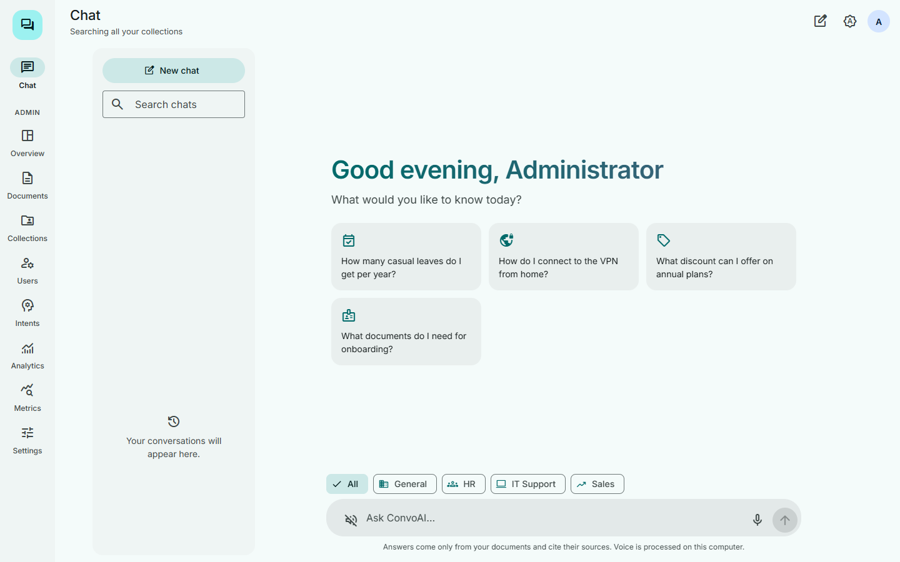

### Asking a question

Type in the box at the bottom and press **Enter** (**Shift + Enter** starts a new line), or click one of the suggested questions. The answer appears word by word. While it's working, a status line shows the step: *Searching your documents…*, *Writing the answer…*.

Each answer has a badge saying how it was answered:

| Badge | Meaning |
|---|---|
| **From documents** | Answered from your documents. The numbers like `[1]` show which passage each fact came from |
| **Quick reply** | Small talk ("hi", "thanks", "who are you?") answered instantly, without searching |
| **Not found in documents** | Nothing relevant was found, so the assistant says so instead of guessing |

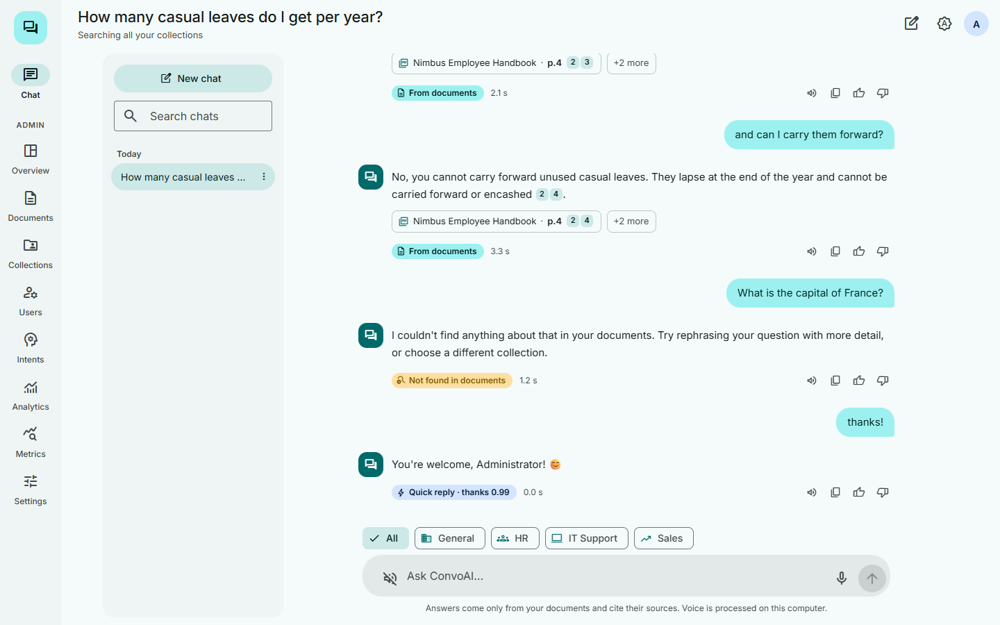

The time next to the badge is how long the full answer took. Hover the badge to see the time for each step.

### Checking the source

Click a citation number such as `2`, or a source chip under the answer (*Nimbus Employee Handbook · p.4*). The **Sources** panel opens with the exact passages the answer used. Cited passages come first, and words from your question are highlighted. Press **Esc** or ✕ to close it.

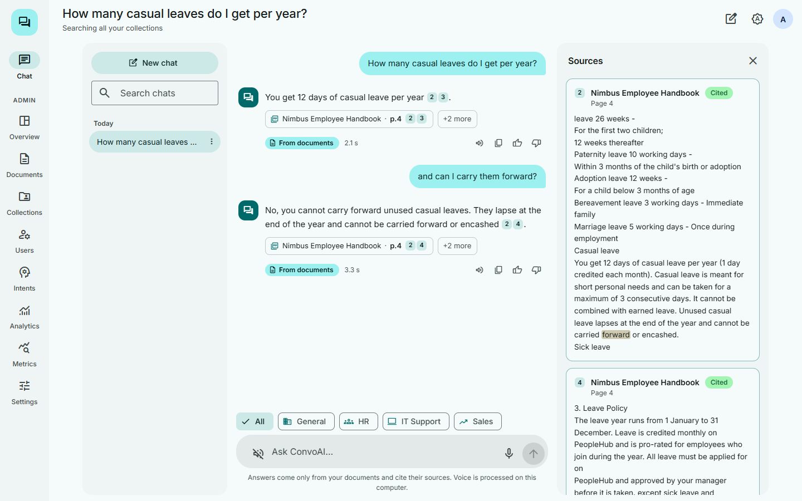

**Always check important details (amounts, deadlines, approvals) in the source.**

### Follow-up questions

You can ask follow-ups naturally, such as *"and can I carry them forward?"* or *"what about sick leave?"*. The assistant works out what "them" or "what about" refers to from the conversation. To start a new topic, click **New chat** (✎).

### Searching one department

The chips above the message box (**All**, **HR**, **IT Support**, **Sales**…) limit the search to one collection. This helps when a word means different things in different departments.

### Voice

- **Ask by voice:** click 🎤 and speak. Recording stops by itself about 1.5 seconds after you finish, or click ■. **Esc** cancels. Your speech is turned into text on this computer (Whisper) and sent as your question. The first time, the browser asks for microphone permission: choose *Allow*.
- **Hear answers:** answers to spoken questions are read aloud automatically. The 🔊 button next to the message box reads *every* answer aloud. Each answer also has its own 🔊 read-aloud button. Only voices installed on this PC are used.

### Your conversations

The left panel lists your chats by day. Use the search box to find one. The ⋮ menu lets you **rename** or **delete** a chat. Each chat has its own address (`/c/24`), so you can bookmark it, and the browser's Back button works. On a phone, the 🕘 button opens this panel.

### Other buttons on an answer

- **Copy**: copies the answer without the citation numbers.
- **👍 / 👎**: tells the administrator whether the answer helped. 👎 answers are listed on the Analytics page so the documents can be improved.
- **■ Stop** (shown while answering): stops the answer. What was written so far is kept.

### Light and dark

The ☀/☾ button in the top bar cycles **system → light → dark**. Your choice is remembered.

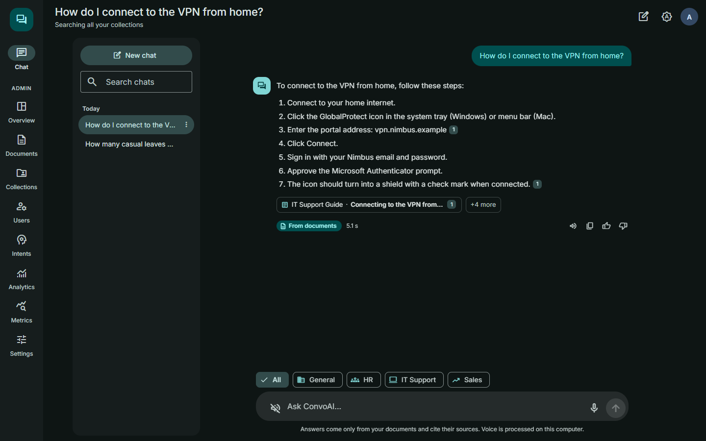

The layout adapts to phones:

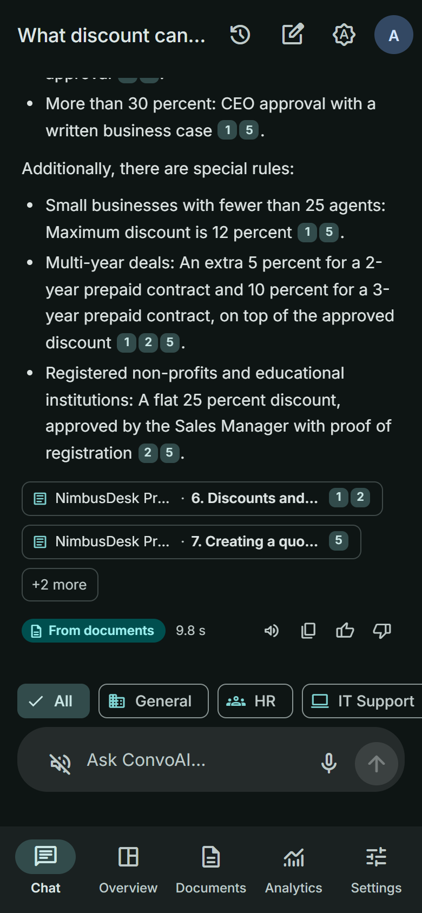

---

## 2. Administration

All admin pages are in the left rail under **ADMIN**. (With sign-in switched on, only admins see them.)

### Overview

System status (database, Ollama, installed models), document and usage counts, and links to every admin page.

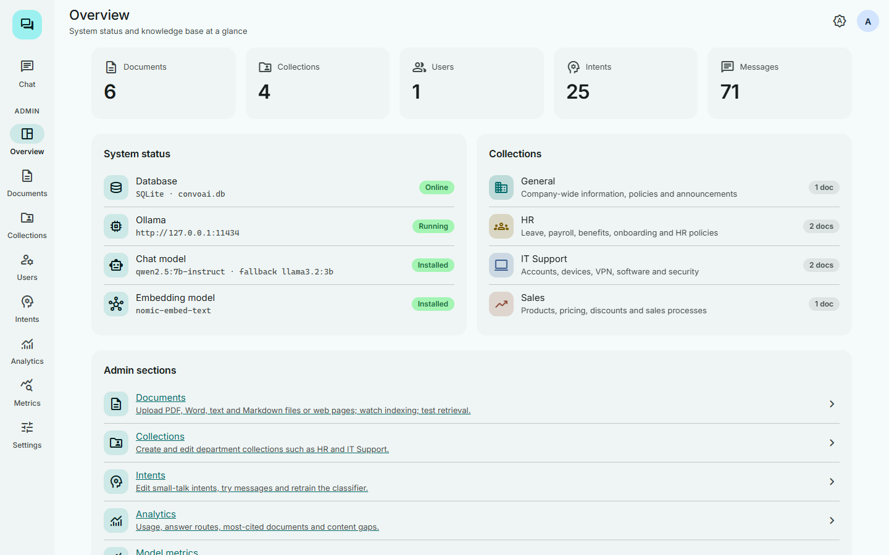

### Documents

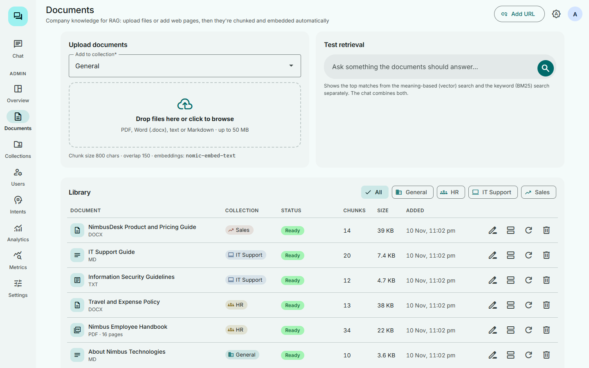

- **Upload:** choose the collection, then drag files onto the drop zone or click it. Supported: **PDF, Word (.docx), text (.txt), Markdown (.md)**, up to 50 MB per upload. Uploading the same file twice to the same collection is skipped.
- **Add URL:** indexes a public web page (its main article text). Addresses on this computer or your local network are refused for safety.
- **Status:** *Queued* → *Processing %* → *Ready* (a 40-page PDF takes about 6 seconds). *Failed* shows the reason, for example a scanned PDF with no text.
- **Row actions:** ✎ rename or move to another collection (instant), ☰ view chunks (the pieces the assistant searches, with page numbers), ⟳ re-index, 🗑 delete (removes the file and its index).
- **Test retrieval:** type a question to see which passages the meaning search and the keyword search find, without asking the model.

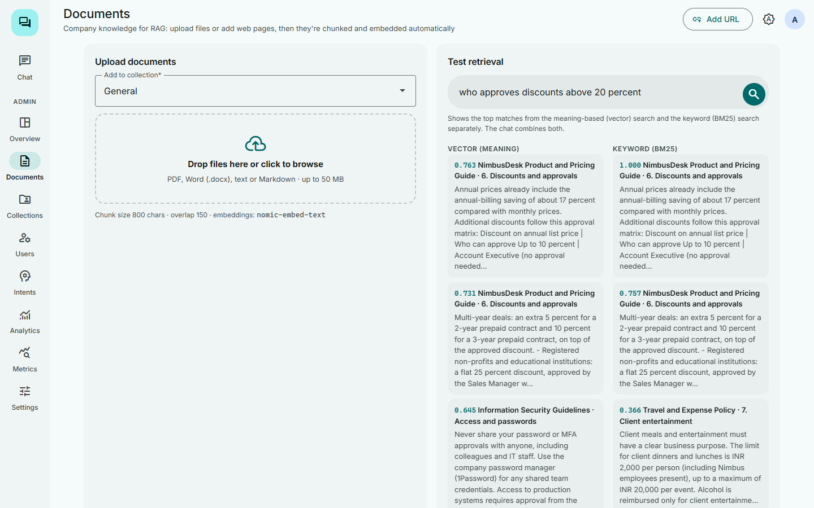

### Collections

Groups of documents, usually one per department. Create, rename, change the icon and colour, or delete. Deleting a collection that still has documents tells you how many will be deleted with it.

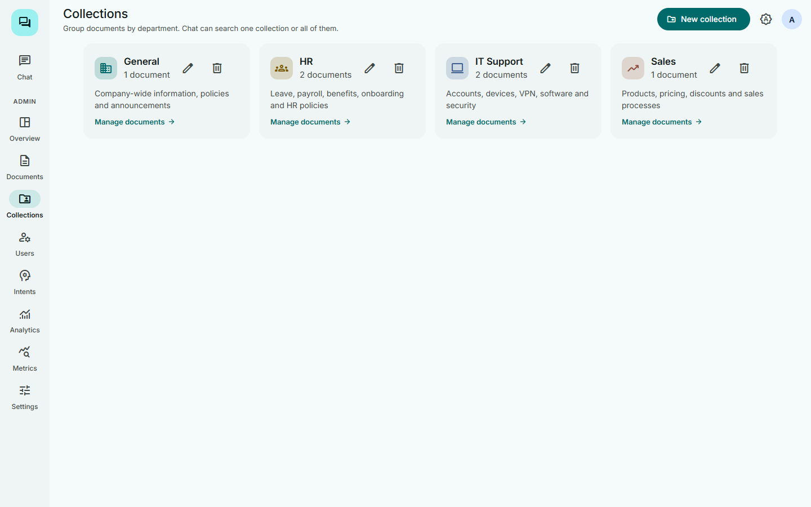

### Intents (small talk)

The *intent classifier* recognises small talk and questions about the assistant, and answers them instantly with a canned reply. Each intent has **example patterns** (ways people say it) and **responses** (one is picked at random; `{name}`, `{time}`, `{date}`, `{day}` and `{collections}` are filled in).

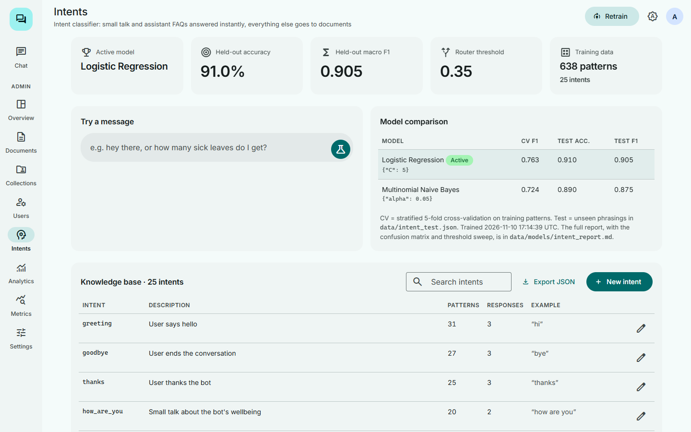

- Click an intent to edit it, or use **New intent**. Give at least 2 patterns; 10–20 varied ones work best.
- After editing, a banner asks you to **Retrain** (about 10 seconds). Until then the chat uses the previous model.
- **Try a message** shows which intent a message gets, how confident the model is, and each text-processing step (normalise → tokens → stop-words removed → lemmas).
- `doc_query` is special: it marks "this is a question for the documents". You can add patterns to it, but it can't be renamed, switched off, deleted or given responses.

### Settings

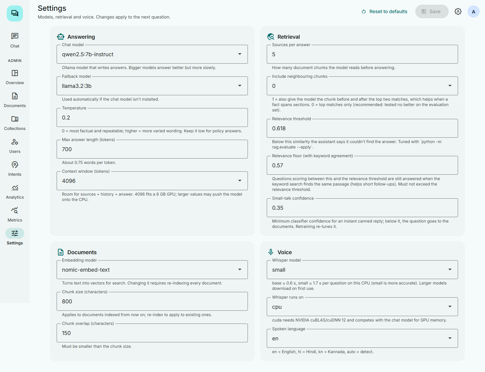

| Group | Setting | Advice |
|---|---|---|
| Answering | Chat model | `qwen2.5:7b-instruct` (default) cites reliably; `llama3.2:3b` is about twice as fast but often leaves out citations |
| | Temperature | Keep low (0.2) for policy answers |
| | Context window | 4096 fits a 6 GB GPU; larger values may push the model onto the CPU (slow) |
| Retrieval | Sources per answer | 5 by default |
| | Relevance threshold / floor | Below the floor, the assistant says "not found". Between the floor and the threshold, it answers only when keyword search agrees. Tuned values: 0.618 / 0.57 |
| | Small-talk confidence | Below it, small-talk-looking messages are sent to the documents instead. Retraining re-tunes it |
| Documents | Embedding model, chunk size, overlap | Changing these needs a re-index. The page offers **Re-index all documents** |
| Voice | Whisper model, device, language | `small` on the CPU (~2 s per question) is the default; `base` is faster but less accurate |

Every value is checked when you save. Out-of-range values and models that aren't installed are rejected with a message. **Reset to defaults** restores the shipped values.

### Users and sign-in

By default there is **no sign-in**: whoever uses this computer is the administrator. To share ConvoAI with several people with separate access (for example HR staff see only HR documents), set `LOGIN_REQUIRED=1` in the `.env` file and restart. Then on **Users** you can create accounts, choose *Admin* or *User*, tick the collections each user may search, reset passwords and deactivate accounts. There is always at least one active admin, and you can't remove your own admin access.

---

## 3. Analytics and model metrics

### Analytics

Everything is calculated from the chat history on this computer. Choose **Last 7 / 30 / 90 days** or **All time** at the top. Every chart has a ☰ button that shows the numbers as a table.

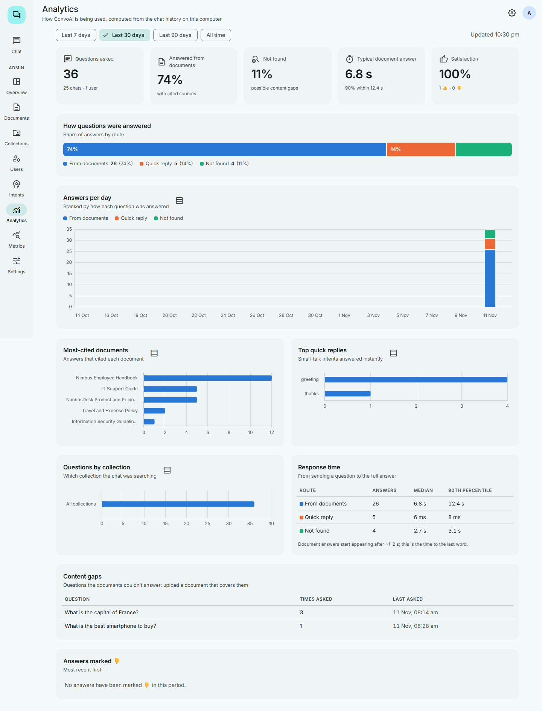

- **Headline numbers:** questions asked, share answered from documents, "not found" rate, typical answer time, satisfaction (👍 share).
- **How questions were answered** and **Answers per day**.
- **Most-cited documents** (which documents earn their keep), **Top quick replies**, **Questions by collection**.
- **Response time** per route (median and 90th percentile).
- **Content gaps:** questions the documents couldn't answer, counted. **This is your to-do list**: add or improve a document that covers them.
- **Answers marked 👎**, each linking to the conversation.

### Model metrics

For checking and explaining the AI's quality.

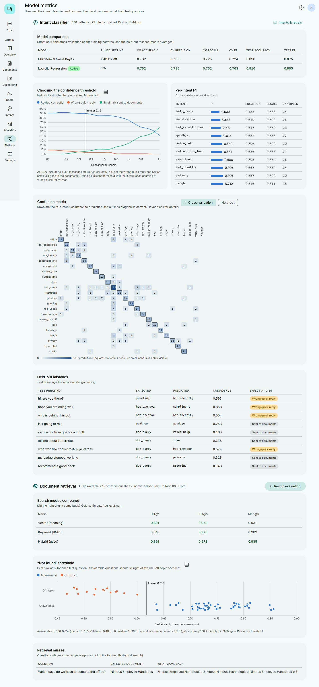

- **Model comparison:** Naive Bayes vs Logistic Regression, on cross-validation and on 100 unseen phrasings. The better model is used.
- **Choosing the confidence threshold:** how routing changes as the small-talk threshold moves; the line marks the value in use.
- **Per-intent F1** (weakest first) and the **confusion matrix:** which intents get mixed up. Add more varied patterns to weak ones.
- **Document retrieval:** how often the right passage is found (hit@1, hit@5, MRR) for meaning, keyword and combined search, and a plot of every test question against the "not found" threshold. **Re-run evaluation** (about 10 seconds) after adding many documents.

---

## 4. Writing documents that answer well

The assistant can only be as good as the documents. From testing:

1. **Use real headings** (Word heading styles, Markdown `#`, numbered sections). Answers cite the section, and searches work better.
2. **Put conditions next to the numbers.** "INR 2,500 per day in metro cities" is answered well only if the document also says, *in the same section*, which cities are metro. Rules split across distant sections are the most common cause of wrong answers.
3. **Spell out tables:** give each row and column a clear label.
4. **One topic per document** where possible, in the right collection.
5. **Avoid scanned PDFs.** They contain pictures of text, which can't be searched. Export from Word instead.
6. **Watch Analytics → Content gaps** and 👎 answers, and fill the gaps.

---

## 5. Privacy

- The language model, the embeddings, speech recognition and your chat history all stay on this computer. Nothing is sent to an online AI service.
- Read-aloud uses only voices installed on this PC; online voices are skipped.
- Chats are stored in `data/convoai.db`. Uploaded files are in `data/uploads/`. Deleting a chat or document removes it.
- Adding a **URL** document fetches that public page once.

---

## 6. Questions and answers

**The answer is wrong. What should I do?** Click 👎, check the cited source, and tell the administrator. Often the document is ambiguous (see part 4).

**It says "couldn't find" but the document has the answer.** Rephrase with the document's own words, or pick the right collection chip. Admins can check with *Test retrieval* on the Documents page.

**Can it answer general questions (news, maths, coding)?** No. On purpose, it only answers from your documents.

**Does it understand Hindi or Kannada?** The interface and documents are in English. Voice input can be set to Hindi or Kannada in Settings, but the answers are only as good as the English documents behind them.

**How do I back it up?** Copy the `data` folder.
